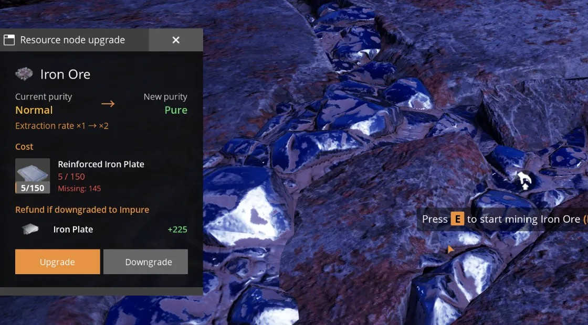
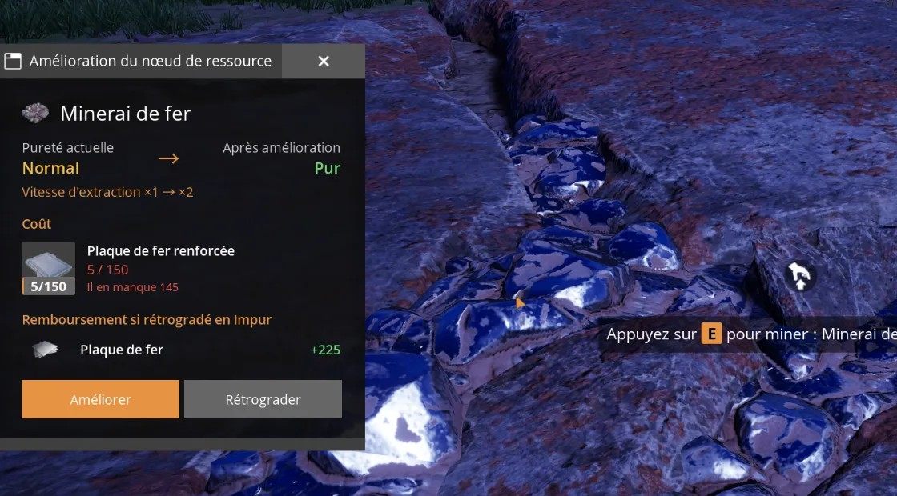

# Node Upgrade

A Satisfactory mod: pay items to raise or lower the purity of any resource node (**Impure → Normal → Pure**). Miners and extractors already built on the node run at the new speed immediately.

**Download and full description: [ficsit.app/mod/NodeUpgrade](https://ficsit.app/mod/NodeUpgrade)**, or install it with Satisfactory Mod Manager.

## Features
- Native-looking menu (key **Y**, rebindable): built from the game's own window, buttons, cost slots, icons and fonts. Press the key again to close it.
- A hint line under the game's look-at prompt, *Press [Y] to upgrade this node*, on nodes you can upgrade and on the miners and extractors built on them. It is inserted into the game's own prompt widget with an SML widget hook and updates only when the looked-at actor changes.
- Instant effect on miners and extractors already standing on the node.
- Downgrade refunds 50% of what was actually paid for that step, rounded down; a node never goes below its original purity.
- Payment and purity change happen together or not at all.
- Saved with the game; no tick and no scan of the map.
- Multiplayer: every player can upgrade and downgrade with their own items, at the server's prices. The server runs the rules; clients send requests through a remote call object and receive the modified nodes and the server's cost table by replication. Windows client and Windows dedicated server packaging have been verified, and a node upgrade has been tested on a dedicated server. Linux server builds and the remaining multiplayer scenarios below still require validation.
- Editable costs in `Resources/costs.json` (`/nu reload` in the chat).
- Optional Ficsit Farming and KLib resource cost entries; see [the mapping and validation notes](docs/sfplus-resources.md). Prices are provisional; compatibility with SF+ and its custom miners still needs testing.
- 13 languages, following the game language.

## Building from source
1. Set up the Satisfactory modding environment (Unreal Engine CSS, Visual Studio 2022, Wwise, SML starter project) as described in the [official modding documentation](https://docs.ficsit.app/satisfactory-modding/latest/).
2. Put the contents of this repository in `Mods/GameFeatures/NodeUpgrade/` of the starter project.
3. Generate the Visual Studio project files and build **Development Editor / Win64**.
4. Package **NodeUpgrade** with **Alpakit Release**. The release targets in `Config/Alpakit.ini` are **Windows**, **WindowsServer**, and **LinuxServer**. Linux cross-compilation requires the matching Unreal Clang toolchain and Linux Wwise deployment platform from the official setup guide.
5. For distribution through ficsit.app, upload the generated **multi-target release zip**. Changing the source configuration alone does not make an existing Windows-only release installable on servers. Increase the plugin version before publishing a new release.

Built against SML 3.12 and game version CL502094 (Satisfactory 1.2). Client: Windows. Dedicated server targets: Windows and Linux. This repository contains only the plugin, not the Unreal/SML starter project or compiled server binaries.

### Dedicated server validation

Install the matching client build on every player and the matching server build on the dedicated server, including compatible SML versions. Keep `Resources/costs.json` on the server: clients receive that table by replication. UI input and widget hooks are initialized only on clients; the subsystem and remote call object remain registered on the server.

Before marking a release as tested on dedicated servers:

- Build and package both server targets successfully, and confirm that each package includes `Resources/costs.json`.
- Start a server without a connected player. Check `FactoryGame.log` for `NodeUpgrade loaded`, a loaded cost table, and no widget-loading errors.
- Connect two clients. Upgrade and downgrade a node through the Y menu; verify the requesting player's payment/refund, both clients' purity display, and the extractor's actual production rate.
- Join after an upgrade, then disconnect and reconnect; verify that prices and modified nodes arrive correctly.
- Save and restart the server; verify that purity and production rates are restored, including resource wells and geothermal generators.
- Change the server's costs and run `/nu reload`; verify both clients receive the updated prices. Also check single-player and hosted multiplayer after these changes.

See the official [dedicated server installation guide](https://docs.ficsit.app/satisfactory-modding/latest/ForUsers/DedicatedServerSetup.html) and [testing guide](https://docs.ficsit.app/satisfactory-modding/latest/Development/TestingResources.html).

| Folder | Contents |
|---|---|
| `Source/` | All the C++ code (menu, look-at hint, rules, save data, targeting, chat commands). |
| `Content/` | The input action, the input mapping context, the Game Feature Data asset and the translations (`Localization/`). |
| `Resources/` | `costs.json` (prices per resource) and the in-game icon. |
| `Config/` | Alpakit and access transformer settings. |

## AI usage
This mod was made with the help of an AI assistant (Anthropic Claude): the C++ code, the translations (not yet reviewed by native speakers), the logo and these texts were written by the AI, following the author's design. Game design, balancing and in-game testing were done by the author.

The menu follows the game language (here in French):

## License
[MIT](LICENSE) for the mod's own code and files.

## Credits
Satisfactory, its item icons and its UI assets belong to Coffee Stain Studios. This mod is not affiliated with Coffee Stain Studios.
